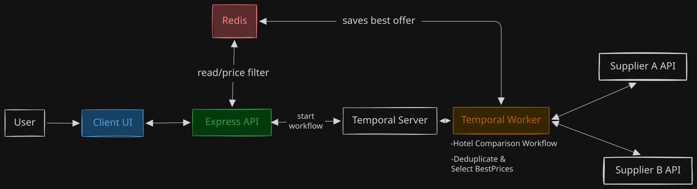

# Hotel Offer Orchestrator

A production-grade hotel offer aggregator and orchestrator built with **Node.js (TypeScript)**, **Express**, **Temporal.io**, **Redis**, and **Docker Compose**.

---

## 1. System Architecture Diagram



### Container Breakdown

The application stack is orchestrated via `docker-compose.yml` across **4 containers**:

| # | Container Name | Service | Image / Build | Port(s) | Role & Description |
|---|---|---|---|---|---|
| **1** | `hotel-orchestrator-api` | `api` | Built from `Dockerfile` (`node:22-slim`) | `3000:3000` | **Express API Gateway & Web UI**: Handles incoming REST requests, Swagger docs (`/api-docs`), health checks, and triggers Temporal workflows. |
| **2** | `hotel-orchestrator-worker` | `worker` | Built from `Dockerfile` (`node:22-slim`) | *Internal* | **Temporal Background Worker**: Subscribes to `HOTEL_OFFER_TASK_QUEUE`, calls suppliers in parallel, runs deduplication logic, and persists to Redis. |
| **3** | `hotel-orchestrator-redis` | `redis` | `redis:7-alpine` | `6379:6379` | **In-Memory Cache & Price Filter**: Stores hotel offers in Hashes and Sorted Sets (`ZSET`) to execute native in-storage price range filtering (`ZRANGEBYSCORE`). |
| **4** | `hotel-orchestrator-temporal` | `temporal` | `temporalio/temporal:latest` | `7233:7233`<br>`8233:8233` | **Temporal All-in-One Engine & Web UI**: Coordinates distributed workflows, retries, and includes the integrated Temporal Web Dashboard on port `8233`. |

---

## 2. Live Production Deployment

The project is deployed and live on Vercel via Docker container runtime:

| Resource | Live Production URL | Status |
| :--- | :--- | :--- |
| **Airbnb-Style Web UI** | [https://hotelassi.vercel.app](https://hotelassi.vercel.app) | `200 OK` |
| **Interactive Swagger API Docs** | [https://hotelassi.vercel.app/api-docs](https://hotelassi.vercel.app/api-docs) | `200 OK` |
| **Deduplicated Offers API** | [https://hotelassi.vercel.app/api/hotels?city=delhi](https://hotelassi.vercel.app/api/hotels?city=delhi) | `200 OK` |
| **In-Memory Price Range Filter** | [https://hotelassi.vercel.app/api/hotels?city=delhi&minPrice=5400&maxPrice=6000](https://hotelassi.vercel.app/api/hotels?city=delhi&minPrice=5400&maxPrice=6000) | `200 OK` |
| **Multi-Dependency Health Check** | [https://hotelassi.vercel.app/health](https://hotelassi.vercel.app/health) | `200 OK` |

Deploy command:
```bash
vercel --prod
```

---

## 3. Startup Scripts and Setup

### Option A: One-Click Automated Script (Recommended)
Run the automated runner which detects Docker, launches all containers, or gracefully falls back to local standalone mode:

```bash
./start.sh
```

### Option B: Run with Docker Compose Directly
```bash
docker compose up --build
```
- **API & Web UI**: [http://localhost:3000](http://localhost:3000)
- **Interactive Swagger Docs**: [http://localhost:3000/api-docs](http://localhost:3000/api-docs)
- **Temporal Web Dashboard**: [http://localhost:8233](http://localhost:8233)
- **Redis Server**: `localhost:6379`
- **Temporal Server (gRPC)**: `localhost:7233`

### Option C: Local Setup (Without Docker)
```bash
# 1. Install dependencies
npm install

# 2. Build TypeScript project
npm run build

# 3. Start API server
npm run dev

# 4. (Optional) Start Temporal Worker in another terminal
npm run dev:worker
```

### Automated Verification Tests
```bash
# Run Redis ZSET in-storage filtering verification
npx tsx src/tests/redis.spec.ts

# Run Temporal deduplication and resilience test
npx tsx src/tests/workflow.spec.ts
```

### Postman Test Suite
Import [`postman_collection.json`](./postman_collection.json) into Postman to run 8 pre-configured test scenarios with automated JavaScript assertions:
1. Valid city with expected overlaps (`city=delhi`)
2. In-Redis price range filtering (`minPrice=5400&maxPrice=6000`)
3. City with no results (`city=unknown`)
4. Validation error handling (`minPrice > maxPrice`)
5. Direct Supplier A verification
6. Direct Supplier B verification
7. Supplier failure simulation (`simulateError=true`)
8. Multi-dependency health check (`/health`)

---

## 4. Working of the Project

The system implements the **MVC architecture** and adheres strictly to **SOLID principles**:

### Step 1: Request & Input Validation (Controller Layer)
- Client sends `GET /api/hotels?city=delhi&minPrice=5400&maxPrice=6000`.
- [`HotelController`](./src/controllers/hotel.controller.ts) validates parameters using **Zod** (`HotelQuerySchema`).
- If `minPrice > maxPrice` or parameters are invalid, an RFC 7807 400 Bad Request error is returned immediately.

### Step 2: Parallel Fetching & Fault Tolerance (Temporal Activities)
- The workflow orchestrates concurrent calls to Supplier A and Supplier B via `Promise.allSettled`.
- **Exponential Backoff**: Activities are configured with retry policies (`maximumAttempts: 3`, `backoffCoefficient: 2`).
- **Resilience**: If one supplier is temporarily offline, the workflow catches the rejection and proceeds with the healthy supplier's inventory without aborting the client request.

### Step 3: Pure Deterministic Deduplication (Temporal Workflow)
- Pure business logic in [`src/temporal/workflows.ts`](./src/temporal/workflows.ts) executes deterministically:
  1. Collates offers by normalized hotel name (e.g. `"Holtin"`).
  2. Compares prices and selects the cheapest offer (`Supplier B` at ₹5,340 vs `Supplier A` at ₹6,000).
  3. Tie-breaker: If prices are identical, the offer with the higher commission percentage is selected.
  4. Preserves unique inventory present in only one supplier.

### Step 4: Native In-Storage Price Range Filtering (Redis)
- Deduplicated results are persisted into Redis using two data structures:
  - **`hotels:zset:{city}` (Sorted Set)**: Score = `price`, Member = `hotelName`.
  - **`hotels:data:{city}` (Hash)**: Field = `hotelName`, Value = JSON object.
- **Price Range Query**:
  ```redis
  ZRANGEBYSCORE hotels:zset:delhi 5400 6000
  HMGET hotels:data:delhi <filteredHotelNames>
  ```
  Price filtering executes directly inside Redis at $O(\log N + M)$ complexity, fulfilling the strict assignment requirement to filter *inside* Redis.

### Step 5: Multi-Dependency Health Check (Bonus Point)
- `GET /health` runs concurrent health checks on all dependencies:
  - **Supplier A** (`/supplierA/health`)
  - **Supplier B** (`/supplierB/health`)
  - **Redis** (`PING`)
  - **Temporal Server** (`client.workflowService.getSystemInfo`)
- Accurately reports overall status (`UP`, `DEGRADED`, or `DOWN`) with response latency in milliseconds.

### API Response Format Example:
```bash
curl "http://localhost:3000/api/hotels?city=delhi&minPrice=5400&maxPrice=6000"
```
```json
[
  {
    "name": "Radison",
    "price": 5900,
    "supplier": "Supplier A",
    "commissionPct": 13
  }
]
```
